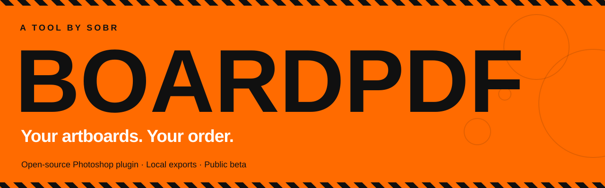

# BoardPDF by SOBR

**Select your Photoshop artboards. Set the page order. Export one PDF.**

BoardPDF is a free, MIT-licensed Photoshop UXP plugin for exporting selected artboards as a multipage PDF or separate PDFs. Everything runs locally. No plugin accounts, API keys, subscriptions, or cloud uploads.

**Public beta:** limited real-host validation on Photoshop 27.11.0 / macOS. Windows and the full integration matrix remain pending. Read the [limitations](#limitations) before using it for final production delivery.

[Download the public beta](https://github.com/sobrdigital/boardpdf/releases/tag/v1.1.0-beta.1) · [Installation guide](docs/INSTALLATION.md) · [Report a bug](https://github.com/sobrdigital/boardpdf/issues/new?template=bug_report.md) · [Agent setup prompt](docs/AGENT_PROMPT.md)

> Beta releases are listed under [all releases](https://github.com/sobrdigital/boardpdf/releases). The package is a ready-to-load ZIP for UXP Developer Tool, not a one-click `.ccx` installer.

## Install in Photoshop

Requires **Photoshop 25.0+** on macOS or Windows and **Adobe UXP Developer Tool**. No Node.js or terminal is required to load the downloaded build.

1. Download **`BoardPDF-1.1.0-beta.1.zip`** from [Releases](https://github.com/sobrdigital/boardpdf/releases), then extract it to a permanent folder.
2. Install [Adobe UXP Developer Tools](https://creativecloud.adobe.com/apps/download/uxp-developer-tools). Launch it and enable Developer Mode when prompted.
3. In Photoshop, enable **Preferences → Plugins → Enable Developer Mode**. Save your work, quit Photoshop completely, and reopen it.
4. In UXP Developer Tool, click **Add Plugin** and choose the extracted **`BoardPDF/manifest.json`**.
5. Click **Load**, then open **Plugins → BoardPDF** in Photoshop.

If you download the repository's source ZIP instead, choose **`dist/manifest.json`**. The root source manifest is a build input, not the plugin folder to load.

See [installation, updates, packaging, and troubleshooting](docs/INSTALLATION.md).

## The workflow

1. **Select in Photoshop.** Select artboards or layers inside them. Only their parent artboards appear in BoardPDF. Nothing selected means an empty panel.
2. **Arrange your pages.** Drag thumbnail rows into order. You can also click a row and use the up/down buttons. The page numbers show the order of checked pages.
3. **Set compression and resolution.** Open **Options** for JPEG quality, transparency, background, filename, or separate-file output.
4. **Export.** Rendering finishes before the save picker opens. Choose where to save, then wait for the saved-file confirmation.

The panel follows Photoshop selection changes. Click **Sync** after editing artwork or to re-import the current selection. Retained artboards keep their relative PDF page order.

**Clear all** empties the panel. **Remove** clears only the active row, even when it is the last row. Neither action deletes Photoshop artboards or layers. Click **Sync** to restore the current Photoshop selection. Unchecking a row excludes it from export without removing it from the list.

## What it does

- Selection-only thumbnails with stable source artboard IDs.
- Arbitrary page order without moving Photoshop artboards or layers.
- Single multipage PDF or separate PDFs, including mixed sizes and orientations.
- JPEG quality 1–100 or lossless RGB transparency.
- Original, 300, 150, 96, and 72 DPI raster output.
- Configurable flatten background, local progress, and cancellation before saving.
- Snapshot checks to prevent stale exports.
- Byte-for-byte verification of saved files before reporting success.
- Compact orange, black, and white UI, with most panel space reserved for arranging pages.

## Compression

| Preset | JPEG quality | Resolution |
| --- | ---: | --- |
| Maximum | 100 | Original |
| Print | 95 | 300 DPI |
| Balanced | 80 | 150 DPI |
| Small file | 55 | 72 DPI |
| Custom | Your setting | Your setting |

Resolution only downsamples pixels. It does not enlarge the source or change the physical PDF page size. Lossless transparency ignores JPEG quality. The JPEG background color applies only to flattened pages; an existing artboard background remains part of the artwork.

**Compression does not guarantee a target file size.** For a delivery limit such as 5 MB, export, check the actual size, and adjust settings if needed. These are image-compression controls, not whole-PDF optimization.

## How the source PSD is protected

BoardPDF creates one private document duplicate inside `executeAsModal`, isolates each selected artboard in that duplicate, and reads its composite pixels. It closes only the duplicate without saving and registers host cleanup. Source IDs are resolved to index paths because copied layer IDs can change.

The original PSD is not edited, saved, closed, cropped, flattened, or reordered. Single-file replacement uses the native save picker's confirmation. Separate mode rejects existing filenames and includes page numbers and artboard IDs to distinguish duplicate names.

## Limitations

| Area | Current behavior |
| --- | --- |
| Output | Raster PDFs. Text and vectors become pixels. |
| Color | 8-bit sRGB, without an embedded ICC profile. CMYK and PDF/X are not retained. |
| Downsampling | Nearest-neighbor sampling. Use Original for detailed print artwork. |
| Size limit | Each source artboard and output raster is capped at 24 megapixels, including when downsampling. |
| Memory | The full document duplicate, page buffers, and assembled PDFs use memory and scratch disk. Use smaller selections for large PSDs. |
| Thumbnails | First 50 imported artboards. Previews read the source composite; export reads the isolated duplicate. |
| Visibility | Selected artboards and ancestors are revealed only in the duplicate. Hidden children stay hidden. |
| Cancellation | Checked between operations and pages. Synchronous JPEG encoding must finish first. Writes cannot be cancelled once started. |
| Write failures | Writes are not transactional. A failed single write can leave a partial file; earlier separate files remain if a later write fails. |
| Validation | Full Windows, picker, dock/drag, real cancellation, unusual effects/masks, and alternate color-mode coverage remain pending. |

A limited real Photoshop check exported two populated artboards in a changed order to a **394,446-byte, two-page PDF**. Written bytes matched generated bytes; the source document/history/selection state matched before and after. The PDF reopened with pdf-lib and its first page rendered through macOS's PDF renderer. This does not claim a full test matrix or Acrobat UI pass.

See [validation notes](validation/RESULTS.md) and the [manual Photoshop checklist](MANUAL_TESTS.md). The latest branding, layout, Clear all, and Remove controls still need a visual host check.

## Develop

Requires Node.js **20+** and npm:

```sh
git clone https://github.com/sobrdigital/boardpdf.git
cd boardpdf
npm ci
npm run check
```

| Command | Purpose |
| --- | --- |
| `npm test` | Run the 13 targeted automated tests |
| `npm run build` | Bundle runtime, assets, manifest, and licenses into `dist/` |
| `npm run check` | Run tests, then build |

Load `dist/manifest.json` in UXP Developer Tool after building. Node.js is build/test only. UXP runtime paths are tested without Node globals, fetch, or canvas.

```text
src/
  main.js              Panel, selection sync, ordering, clear/remove
  model.js             Settings, dimensions and selection logic
  documentService.js   Discovery and document snapshots
  renderSession.js     Private duplicate and isolation
  renderService.js     Imaging API reads and thumbnails
  pdfService.js        JPEG/lossless PDF assembly
  exportService.js     Prepare, choose destination, write, verify
  settingsService.js   Local preferences
assets/                Plugin brand assets
dist/                  Ready-to-load plugin
scripts/build.js       Build and dependency-license copying
tests/                 Targeted automated tests
docs/                  Setup and agent handoff
```

The plugin ID remains `digital.sobr.artboardpdfexporter` to preserve existing development installations and settings while the product name becomes BoardPDF.

## Contribute

Read [CONTRIBUTING.md](CONTRIBUTING.md) and [AGENTS.md](AGENTS.md). Include the Photoshop version, OS, export settings, and a minimal reproduction when reporting issues. Never upload client artwork, credentials, or logs containing private data.

For agent-assisted setup or development, use the [agent prompt](docs/AGENT_PROMPT.md).

## License

Copyright © 2026 SOBR Digital. BoardPDF is released under the [MIT License](LICENSE). Third-party components retain their respective licenses in `dist/licenses/`.

This is an independent plugin and is not affiliated with or endorsed by Adobe. Adobe and Photoshop are trademarks of their respective owners.

Built with [Adobe UXP](https://developer.adobe.com/photoshop/uxp/), [pdf-lib](https://pdf-lib.js.org/), and [jpeg-js](https://github.com/jpeg-js/jpeg-js).
